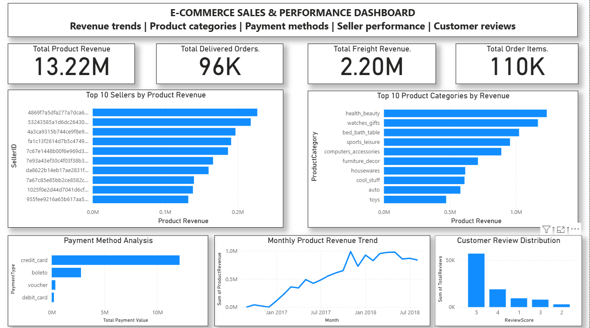

# E-commerce Analytics Engineering with SQL Server

## Project Overview

An end-to-end data analytics project using Microsoft SQL Server, Python, and Power BI to analyze the Brazilian E-Commerce Public Dataset by Olist.

The project covers data ingestion, data quality validation, SQL analytics, reporting views, and an interactive Power BI dashboard.

## Business Objectives

- Analyze monthly product revenue and revenue growth.
- Identify top-performing product categories.
- Understand payment method distribution.
- Evaluate customer review scores.
- Compare seller performance.
- Present key business metrics through an executive dashboard.

## Technology Stack

- Microsoft SQL Server 2022 Express
- T-SQL
- Python and pandas
- pyodbc
- Power BI Desktop
- Git and GitHub

## Data Architecture

The project organizes data into three SQL Server schemas:

- **staging** — source datasets loaded into SQL Server.
- **analytics** — analytical transformations and calculations.
- **reporting** — views prepared for reporting and Power BI.

### Data Sources

The project uses the following Olist datasets:

- Orders
- Customers
- Order items
- Order payments
- Order reviews
- Products
- Sellers
- Geolocation
- Product category name translations

The raw datasets are stored locally and are excluded from Git version control.

## Data Quality and Validation

Validation activities include:

- Checking source row counts.
- Reviewing product category and translation coverage.
- Checking geolocation coordinates and state coverage.
- Identifying products with missing categories.
- Validating reporting outputs.

Two additional product category mappings were added for categories missing from the supplied translation file. These are project-specific mappings and should not be interpreted as original source translations.

## SQL Reporting Views

The following reporting views were created in SQL Server:

| View | Purpose |
|---|---|
| `reporting.vw_monthly_revenue` | Monthly delivered product revenue, freight revenue, orders, and order items |
| `reporting.vw_category_performance` | Product category performance |
| `reporting.vw_payment_performance` | Payment method analysis |
| `reporting.vw_review_performance` | Customer review score analysis |
| `reporting.vw_seller_performance` | Seller performance analysis |

## Dashboard Preview

## Power BI Dashboard

The Power BI report is available at:

`powerbi/Ecommerce_Analytics_Dashboard.pbix`

The **Executive Overview** page contains:

- KPI cards for product revenue, delivered orders, freight revenue, and order items.
- Monthly product revenue trend.
- Top 10 product categories by revenue.
- Payment method analysis.
- Customer review score distribution.
- Top 10 sellers by product revenue.

## Key Business Findings

- Health and beauty was the highest-revenue category among the analyzed categories.
- Credit cards represented the largest payment-value segment.
- Five-star reviews were the most common review score.
- Seller performance varied across revenue, order count, and item volume.
- Monthly delivered product revenue varied throughout the reporting period.

These findings describe the analyzed dataset and should not be interpreted as representing the entire e-commerce industry.

## Metric Definitions and Limitations

- **Product revenue:** Sum of item prices for delivered orders.
- **Freight revenue:** Freight charges reported separately from product revenue.
- **Profit:** Not calculated in this project.
- **Average payment value:** Calculated at the payment-record level, not necessarily the order level.
- **Review distribution:** Based on the reviews included in the reporting view.
- **Missing categories:** Products with missing category information are not assigned invented source values.

## Running the Project

1. Install Microsoft SQL Server and configure a database connection.
2. Create the `EcommerceAnalytics` database.
3. Create the required schemas and load the source datasets into the staging tables.
4. Load the product category translation data.
5. Create and validate the reporting views.
6. Open `powerbi/Ecommerce_Analytics_Dashboard.pbix` in Power BI Desktop.
7. Connect or update the SQL Server data source to match your local environment and refresh the report.

The database server name and connection settings may need to be adjusted for your environment.

## Dataset Attribution

**Dataset:** Brazilian E-Commerce Public Dataset by Olist.

Source: https://www.kaggle.com/datasets/olistbr/brazilian-ecommerce

Refer to the original dataset page for attribution and licensing requirements.

## Project Status

**Status: Completed**

The project includes data ingestion, data quality validation, SQL analytics, reporting views, and an interactive Power BI dashboard.

Project documentation and the dashboard preview have been published to GitHub.

The project is ready to showcase in a professional portfolio.
